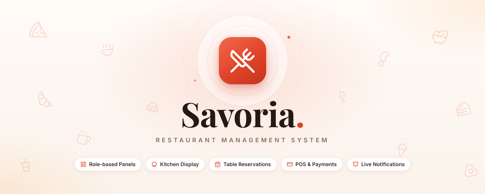

<div align="center">



# 🍽️ Savoria

### *A complete restaurant, from the dining room to the kitchen, in one web app*

[](https://savoria-client-side.vercel.app)
[](https://savoria-server-side.onrender.com/api/health)

[](https://github.com/Galib-272/Savoria_client_side)
[](https://github.com/Galib-272/Savoria_server_side)


---

### ✨ One menu. Seven panels. Every order in real time.

> *Order online · Book a table · Cook · Serve · Deliver · Get paid · See the numbers*

**Savoria** connects every person in a restaurant. Customers order and reserve from the website, cashiers ring up walk-ins on the POS, the kitchen sees tickets the moment they arrive, waiters and riders pick up what's ready, and managers watch it all happen on live dashboards — without anyone pressing refresh.

</div>

---

## ⚡ Highlights

| Feature | What it does |
|---------|--------------|
| 🔐 **Role-based access** | Seven separate experiences — Admin, Manager, Cashier, Kitchen, Waiter, Delivery and Customer. Every page is guarded, so each person only sees and does what their role allows. New sign-ups are always customers. |
| 🔔 **Live notifications, no duplicates** | Socket.IO pushes each event exactly once, only to the panels that should see it. Your own actions land in your bell instantly; other people's actions also pop up. |
| 🍔 **Category menu with dropdowns** | 14 categories and 96 dishes. Tap a category card (Burgers, Pizza, Biryani, Drinks…) to drop down every dish inside, with photos, prices and quick add-to-cart. |
| 🎚️ **Smooth filters & search** | Two-handle price slider, "available now" and "on offer" filters, and instant search that opens every matching category. |
| 🧾 **POS for walk-in orders** | Category dropdowns to add dishes fast, table/seat picking, coupons, tax, and cash, card, mobile-banking or bank-transfer payment with receipts. |
| 👨‍🍳 **Kitchen display** | New → Preparing → Ready board that updates the second an order is placed, plus served, takeaway and delivery hand-over views. |
| 📅 **Table reservations** | Pick a date, time, table and seats; overlapping bookings are blocked and waiters confirm requests live. |
| 💳 **Demo Stripe checkout** | A realistic card payment screen that accepts any amount — perfect for demos, no real money is charged. |
| 📊 **Real analytics** | Admin & manager dashboards with sales, revenue vs. expenses, best sellers, categories, order types and payment methods — all from live data. |
| 🟢 **Continue with Google** | One-click customer sign-in with Google, alongside email and password. |
| 📱 **Fully responsive** | Checked at phone (360 px), tablet (768 px) and desktop widths with no sideways scrolling. |

---

## 👥 The Seven Panels

| Role | Lands on | What they can do |
|------|----------|------------------|
| 👑 **Admin** | `/dashboard` | Everything — staff, menu, inventory, suppliers, reports, audit log, settings |
| 🧑‍💼 **Manager** | `/dashboard` | Runs daily operations: orders, menu, tables, reservations, inventory, staff (no audit log / admin-only actions) |
| 💵 **Cashier** | `/dashboard/pos` | POS terminal, collect payments (cash, card, mobile banking, bank transfer), transaction history, cancel orders |
| 👨‍🍳 **Kitchen** | `/dashboard/kitchen` | Live cooking board, mark orders preparing / ready, served · takeaway · delivery views |
| 🧑‍🍳 **Waiter** | `/dashboard/tables` | Floor map, claim ready dishes, mark served, confirm table reservations |
| 🛵 **Delivery** | `/dashboard/delivery` | Pick up, go out for delivery, mark delivered, delivery history |
| 🙋 **Customer** | `/` | Browse the menu, cart & checkout, track orders, reserve tables, write reviews |

---

## 🗺️ Pages

### 🌐 Public & Customer

| Route | Description |
|-------|-------------|
| `/` | Hero slider, browse-by-category tiles with dish dropdowns, featured dishes, offers and reviews |
| `/menu` | Category cards that drop down their dishes, search, sort and price filters |
| `/menu/[id]` | Dish details, add-ons (size, extras), reviews |
| `/offers` | Live coupon offers |
| `/about` · `/contact` | Restaurant story, hours, map and contact form |
| `/login` · `/register` · `/forgot-password` | Email/password and Google sign-in |
| `/cart` · `/checkout` | Dine-in (table & seats), takeaway or delivery, coupons, demo card payment |
| `/orders` · `/order-tracking` | Order history and a live status timeline |
| `/reservations` | Book a table with real-time seat availability |
| `/profile` | Personal details and avatar |

### 🛠️ Dashboard (staff)

| Route | Description |
|-------|-------------|
| `/dashboard` | KPIs and live charts (admin & manager) |
| `/dashboard/orders` | All orders with role-specific actions |
| `/dashboard/pos` | POS terminal · `/transactions` · `/profile` |
| `/dashboard/kitchen` | Cooking board · `/served` · `/takeaway` · `/delivery` |
| `/dashboard/tables` | Floor map and waiter workflow |
| `/dashboard/delivery` | Active deliveries · `/history` |
| `/dashboard/reservations` | Booking requests and confirmations |
| `/dashboard/menu` | Add / edit dishes — category dropdowns open a dish's edit form |
| `/dashboard/inventory` · `/suppliers` | Stock levels, low-stock alerts, purchases and expenses |
| `/dashboard/staff` | Staff accounts and roles |
| `/dashboard/reports` | Sales, revenue, best sellers and more |
| `/dashboard/audit-logs` | Every important action, who did it and when (admin) |
| `/dashboard/settings` | Restaurant details, tax and delivery fee (admin) |

---

## 🏗️ Tech Stack

| Technology | Purpose |
|------------|---------|
| **Next.js 13** (App Router) + **React 18** | Pages, routing and client components |
| **TypeScript** | Type-safe code end to end |
| **Tailwind CSS** + **shadcn/ui** (Radix UI) | Design system, dialogs, popovers, sliders |
| **Socket.IO client** | Live orders, tables and notifications |
| **Recharts** | Dashboard and report charts |
| **Sonner** | Toast notifications |
| **Google Identity Services** | "Continue with Google" |
| **Lucide** | Icons |

---

## 🚀 Run It Locally

```bash
git clone https://github.com/Galib-272/Savoria_client_side.git
cd Savoria_client_side
npm install
```

Create a `.env.local` file (see `.env.example`):

```env
NEXT_PUBLIC_API_URL=http://localhost:5001/api
NEXT_PUBLIC_SOCKET_URL=http://localhost:5001
NEXT_PUBLIC_GOOGLE_CLIENT_ID=your-google-oauth-client-id.apps.googleusercontent.com
```

Start the [backend](https://github.com/Galib-272/Savoria_server_side) first, then:

```bash
npm run dev        # http://localhost:3000
npm run build      # production build
npm run lint       # code checks
```

> The Google button only appears when `NEXT_PUBLIC_GOOGLE_CLIENT_ID` is set, and the site's address must be listed under *Authorized JavaScript origins* in Google Cloud.

---

## ☁️ Deployment

| Part | Platform | URL |
|------|----------|-----|
| 🖥️ Frontend | Vercel | [savoria-client-side.vercel.app](https://savoria-client-side.vercel.app) |
| ⚙️ Backend | Render (always-on Node server for Socket.IO) | [savoria-server-side.onrender.com](https://savoria-server-side.onrender.com/api/health) |

Every push to `main` redeploys automatically. On the free Render plan the API sleeps after 15 minutes without visitors, so the very first request can take up to a minute.

---

## 📂 Source Repositories

| Role | Repository |
|------|------------|
| 🖥️ **Frontend** | [github.com/Galib-272/Savoria_client_side](https://github.com/Galib-272/Savoria_client_side) |
| ⚙️ **Backend API** | [github.com/Galib-272/Savoria_server_side](https://github.com/Galib-272/Savoria_server_side) |

---

## 📈 Commit History

| Repository | Commits |
|------------|---------|
| Frontend | 80+ commits — pages, role guards, live notifications, POS, kitchen board, menu redesign, responsive fixes |
| Backend | 70+ commits — REST API, JWT & roles, Socket.IO rooms, orders & payments, reservations, menu catalog |

---

## 📄 License

Copyright © 2026 **Savoria**. Built for educational purposes — all designs, schemas and assets are shared under educational distribution guidelines.

**Developed with ❤️ by** — *Syed Ahmad Galib*

---

<div align="center">

**⭐ If Savoria made you hungry, give it a star!**

</div>
